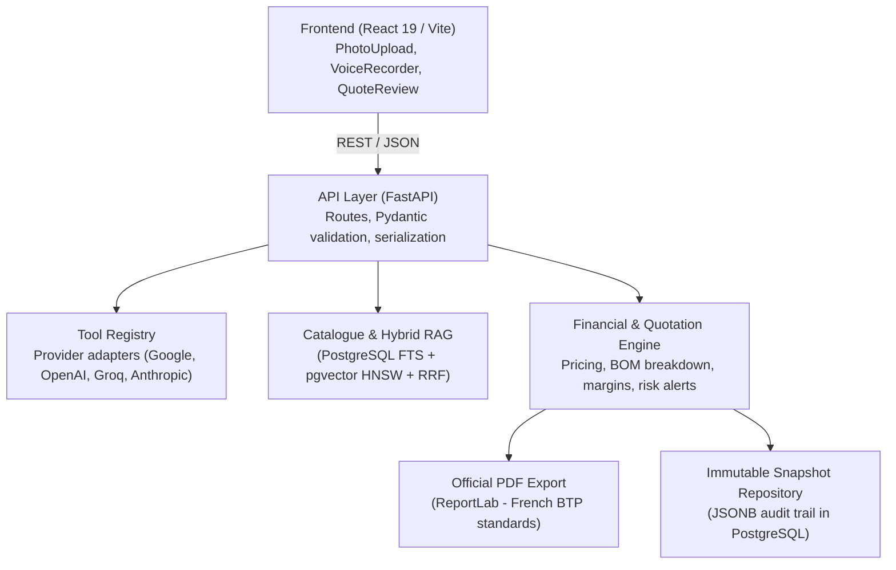

# Architecture & Technical Design - AI Quotation Module

This document outlines the software architecture, design principles, retrieval algorithms, and deterministic financial calculations implemented in the **AI Quotation Module** (`moduleDevisAI`).


## 1. Guiding Principles & Overview

The AI Quotation Module solves a fundamental inefficiency in the construction (BTP) industry: **the slow, error-prone translation of informal field inputs** (voice notes recorded in transit, site photos, unstructured customer notes) into fully costed, formal quotations.

Four architectural tenets govern the system:
1. **Native Multimodality:** Unified handling of text, voice, and imagery.
2. **Grounded Hybrid RAG:** Strict anchoring to the company's verified item catalogue via tenant-isolated lexical and vector retrieval.
3. **Absolute Financial Determinism (Zero Hallucination Policy):** Large Language Models (LLMs) are restricted to semantic interpretation and catalog item selection. Under no circumstances are LLMs allowed to generate, alter, or compute prices, costs, or profit margins.
4. **Provider-Agnostic Tool Registry:** Complete decoupling from underlying AI inference providers (Google, OpenAI, Groq, Anthropic) via the Adapter Design Pattern.


## 2. Layered Architecture (Clean Architecture)

The module enforces strict separation of concerns, ensuring domain logic remains completely decoupled from external frameworks and AI providers:



### Layer Responsibilities:
- **`api/` (Presentation & HTTP Delivery):** REST endpoint controllers, Pydantic request/response validation (`PhotoAnalyzeRequest`, `MatchRequest`, `QuotePdfRequest`), HTTP error handling (400, 413, 422, 500), and payload formatting.
- **`toolregistry/` (AI Infrastructure):** Encapsulates SDK integrations (Google GenAI, OpenAI, Groq). Standardizes input/output contracts across text generation, computer vision, and speech-to-text.
- **`catalog/` (Data & Retrieval Layer):** Vector embedding generation, multi-criteria PostgreSQL querying, and Reciprocal Rank Fusion (RRF) computation.
- **`devis/` (Core Domain Logic):** Pure financial computation, Bill of Materials (BOM) cost rollups, gross profit calculation, commercial risk alerting, and vector PDF rendering.


## 3. Multimodal Ingestion Pipeline

The module supports three primary input modalities:

### 3.1. Voice Notes (On-Site Audio Recordings)
1. **Client Capture:** Audio recorded via the browser Web MediaRecorder API with real-time waveform visualization rendered on an HTML5 Canvas.
2. **Transmission:** Binary audio stream or Base64 payload transmitted to `POST /api/v1/devis/vocal-transcribe`.
3. **Specialized Inference:** Routed to **Whisper Large v3 Turbo** (hosted on Groq for sub-1.5s latency) or **Whisper-1** (OpenAI).
4. **Construction Domain Priming:** A tailored system prompt (`prompts/audio_transcription_prompt.txt`) injects specialized French construction terms (*placo BA13, ragréage, multicouche PER, sous-couche, fêtage, écran de sous-toiture*) into the model's vocabulary, reducing word error rates on technical jargon.
5. **Interactive Review:** Transcribed text is displayed immediately in an editable textarea, enabling the user to adjust or supplement the scope before triggering catalogue matching.

### 3.2. Construction Site Photos
1. **Client-Side Validation:** The [`PhotoUpload.jsx`](../frontend/src/components/PhotoUpload.jsx) component validates MIME types (`image/jpeg`, `image/png`) and restricts uploads to 10MB to prevent bandwidth exhaustion.
2. **Vision Model Analysis:** Processed via `POST /api/v1/devis/photo-analyze` using **Google Gemini Flash** enforced with a strict JSON schema:
   - Room or area type (e.g., *Bathroom, Kitchen, Roofing*).
   - Estimated surface area in square meters ($m^2$) along with a confidence coefficient (`confidence_surface` from 0.0 to 1.0).
   - Detection of visible dimensional references (e.g., *standard door 2.04m, 60x60 tiles, electrical outlets*).
   - Identified materials classified into visual chromatic categories (tiles, wood, paint, plaster, concrete, metal, glass, PVC, sanitary ware).
   - Detection of structural anomalies, degradation, and technical uncertainties.
3. **7-Stage Resilient Fallback Parser:**
   Vision models occasionally wrap outputs in conversational markdown or introduce trailing commas. The `_parse_structured_vision` function in `api/routes.py` executes a multi-tiered repair strategy:
   - Extraction of markdown JSON fences (` ```json `).
   - Removal of internal thinking monologue blocks (`part.thought == True`).
   - Trailing comma removal.
   - Automatic termination of unclosed quotes and braces.
   - Field-by-field regular expression extraction as a resilient last resort.
4. **Thinking Budget Suppression:** For Gemini 3.7+ and 3.8 models, `thinking_budget` is explicitly set to 0 (`GOOGLE_THINKING_BUDGET=0`), eliminating internal reasoning tokens that previously caused 422 JSON validation failures.


## 4. Grounded Hybrid RAG (Catalogue Matching)

In construction, pure vector cosine similarity often fails: terms like *"laying floor tiles"* (*pose carrelage*) and *"removing floor tiles"* (*dépose carrelage*) share nearly identical vector representations despite representing distinct physical operations with completely different unit costs.

To guarantee precision, the system implements **Hybrid Search with Reciprocal Rank Fusion (RRF)**.

### 4.1. Dual-Index Database Schema
The PostgreSQL schema (`database/migrations/001_catalogue.sql`) deploys two complementary indexes:
- **Lexical GIN Index:** Maintained on a generated `search_document TSVECTOR` column powered by PostgreSQL's `french` dictionary:
  $$\text{to\_tsvector}('french', \text{label} \mathbin{\Vert} \text{description} \mathbin{\Vert} \text{sku\_catalogue})$$
- **Semantic Vector Index:** HNSW index (`vector_cosine_ops`) over a 768-dimensional embedding vector (`VECTOR(768)`) generated by `google/embeddinggemma-300m` or `sentence-transformers`.

### 4.2. Reciprocal Rank Fusion (RRF)
The `HybridCatalogueRetriever` (`catalog/hybrid_retriever.py`) executes a unified query combining lexical and semantic rankings:

$$\text{RRF\_Score}(d) = \sum_{m \in \{\text{lexical}, \text{semantic}\}} \frac{1}{k + \text{rank}_m(d)}$$

where the rank constant $k$ defaults to 60 (`CATALOGUE_RRF_K=60`).

```sql
WITH query_terms AS (
    SELECT to_tsquery('french', array_to_string(tsvector_to_array(to_tsvector('french', %(query)s)), ' | ')) AS tsquery
), lexical AS (
    SELECT c.id, ts_rank_cd(c.search_document, q.tsquery) AS lexical_score,
           row_number() OVER (ORDER BY ts_rank_cd(c.search_document, q.tsquery) DESC) AS rank
    FROM catalogue_items c CROSS JOIN query_terms q
    WHERE c.company_id=%(company_id)s AND c.actif AND c.search_document @@ q.tsquery
    LIMIT %(candidate_limit)s
), semantic AS (
    SELECT id, embedding <=> %(embedding)s::vector AS semantic_distance,
           row_number() OVER (ORDER BY embedding <=> %(embedding)s::vector) AS rank
    FROM catalogue_items
    WHERE company_id=%(company_id)s AND actif AND embedding IS NOT NULL
    LIMIT %(candidate_limit)s
), fused AS (
    SELECT id, sum(1.0 / (%(rrf_k)s + rank)) AS rrf_score
    FROM (SELECT id, rank FROM lexical UNION ALL SELECT id, rank FROM semantic) ranks
    GROUP BY id
)
SELECT c.id, c.sku_catalogue, c.item_type, c.label, c.description, c.unite, c.unit_cost,
       f.rrf_score, l.lexical_score, s.semantic_distance
FROM fused f JOIN catalogue_items c ON c.id=f.id
LEFT JOIN lexical l ON l.id=c.id LEFT JOIN semantic s ON s.id=c.id
ORDER BY f.rrf_score DESC, c.id ASC LIMIT %(limit)s;
```

### 4.3. Multi-Tenant Isolation
All queries strictly enforce `c.company_id = %(company_id)s`, guaranteeing zero cross-tenant data leakage in multi-company environments.


## 5. Deterministic Financial Engine (Zero Hallucination Policy)

### 5.1. Strict LLM/Financial Decoupling
The LLM prompt context (`catalogue_prompt_context` in `devis/matching.py`) strictly excludes pricing:
```python
def catalogue_prompt_context(candidates: list[dict[str, Any]]) -> list[dict[str, str]]:
    return [
        {
            "sku_catalogue": row["sku_catalogue"],
            "type": row["item_type"],
            "label": display_text(row["label"]),
            "description": display_text(row.get("description", "")),
            "unite": row["unite"],
        }
        for row in candidates
        if row["item_type"] == "prestation"
    ]
```

The LLM returns only catalogue SKUs and extracted quantities.

### 5.2. Bill of Materials (BOM) Decomposition
The financial engine (`devis/financial_service.py` and `devis/catalogue_pricing.py`) queries `catalogue_item_components` to retrieve the underlying technical recipe for each service:
- Services (e.g., *60x60 Ceramic Floor Tiling*) decompose into elementary components:
  - **Materials:** Porcelain tile ($1.05\text{ m}^2/\text{m}^2$), flexible adhesive ($5\text{ kg}/\text{m}^2$), grout ($0.8\text{ kg}/\text{m}^2$).
  - **Labor:** Professional tile setter ($0.75\text{ h}/\text{m}^2$).
- Unit cost of goods sold is computed deterministically:
  $$\text{Service Unit Cost} = \sum_{i} (\text{Component Quantity}_i \times \text{Component Unit Cost}_i)$$
- Subtotals, profit margins, and tax figures are calculated using Python `Decimal` to eliminate IEEE-754 floating-point inaccuracies:
  $$\text{Subtotal HT} = \text{Quantity} \times \text{Unit Sale Price}$$
  $$\text{Margin (€)} = \text{Subtotal HT} - \text{Total Cost}$$
  $$\text{Margin (\%)} = \frac{\text{Margin (€)}}{\text{Subtotal HT}} \times 100$$

### 5.3. Automated Commercial Risk Alerts
Alerts are dynamically attached to line items and the quote summary:
- **Low Margin Alert:** If $\text{Margin (\%)} < 15\%$, a warning flags risk of negative profitability or unabsorbed overhead.
- **High Margin Alert:** If $\text{Margin (\%)} > 40\%$, a warning alerts the estimator to potential loss of price competitiveness.


## 6. Snapshot Traceability & Vector PDF Export

### 6.1. Immutable Audit Snapshots
When an estimator finalizes a quotation, `quotation_snapshots` stores an immutable copy of all line items, BOM breakdowns, and financial summaries as `JSONB`. Future catalogue updates or cost changes never overwrite or corrupt historically finalized quotes.

### 6.2. Vector PDF Generation (ReportLab)
The `devis/pdf_export.py` module renders high-resolution, print-ready A4 documents conforming to French commercial standards:
- Official contractor header (legal name, address, contact details, SIRET registration).
- Customer identity and job site delivery address.
- Unique reference number, issue date, and tax rates.
- Itemized pricing table with units, quantities, unit prices HT, and line subtotals HT.
- Hierarchical sub-item breakdown (materials vs. labor).
- Accounting summary: Total HT, VAT breakdown (20%), Total TTC.
- Legal approval block: *"Bon pour accord - Date et signature du client"*.


## 7. Frontend Design (React 19 + Vite)

The UI emphasizes ergonomics and responsive feedback:
- **Tabbed Modal Navigation:** Instant switching between Text, Voice, and Photo modes.
- **Dynamic Waveform Visualizer:** Reassures users of microphone input during voice dictation.
- **PhotoUpload Component:** Drag-and-drop zone with real-time file validation, confidence rating banners, color-coded material chips, and a one-click *"Validate → Edit Quote"* pipeline.
- **Real-Time Client Recalculation ([`QuoteReview.jsx`](../frontend/src/components/QuoteReview.jsx)):** Adjusting quantities or components triggers immediate client-side margin and total updates without blocking network round-trips.
- **Integrated PDF Download:** Consumes binary blobs from the backend, captures the `X-Quotation-Snapshot-Id` response header, and triggers downloads with traceable filenames (`devis-DEV-IA-...-snap{id}.pdf`).